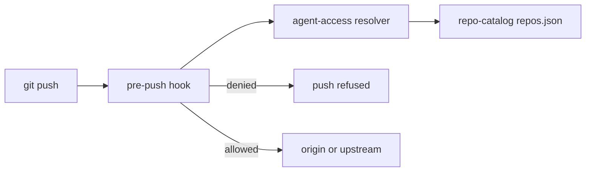

# Agent access

Agent access answers one question for one repository. How much may an AI agent do
against it? The policy is intent, and it lives in
[`repo-catalog`](https://github.com/simpsonm09-org/simpsonm09-repo-catalog). The
resolver and the push guard live here, because the standard owns enforcement.

## The level

`repos.json` carries a default per tier in `agentAccessDefaults` and an optional
`agentAccess` override on a repository. The effective level is the override when
present, otherwise the tier default. The levels, strictest first, are `none`,
`read`, `propose`, `merge`, and `full`.

## Capabilities

An enforcement point never asks for a level. It asks whether the repository grants a
capability, so the mapping from the policy to a decision lives in one table in
[`../../scripts/agent-access.mjs`](../../scripts/agent-access.mjs).

| Level | Grants |
| --- | --- |
| `none` | Nothing. |
| `read` | `read` |
| `propose` | `read`, `pushBranch`, `openPr` |
| `merge` | `read`, `pushBranch`, `openPr`, `mergePr` |
| `full` | `read`, `pushBranch`, `openPr`, `mergePr`, `pushMain`, `admin` |

## The resolver

[`../../scripts/agent-access.mjs`](../../scripts/agent-access.mjs) reads the catalog
and resolves one repository.

```bash
node scripts/agent-access.mjs simpsonm09-repo-catalog              # prints the level
node scripts/agent-access.mjs simpsonm09-browser-calculator --json # prints the level, tier, and source
node scripts/agent-access.mjs simpsonm09-repo-catalog --allows pushMain  # exits 1 when denied
node scripts/agent-access.mjs pstack-max --host github.com \
  --destination simpsonm09/pstack-max \
  --intent '{"operation":"push","capability":"pushBranch","readOnly":false,"resolved":true,"refs":[{"kind":"branch","name":"feat/x","isDefault":false}]}' \
  # exits 0 when the destination may be written this way, 1 when it may not, 2 on usage
```

The `--allows` mode exits `0` when the level grants the capability and `1` when it
does not, so a shell caller branches on the exit code.

### Exact owned repositories

`owned-repositories.json` in the catalog can list exact repositories owned by
`simpsonm09` that have no recorded upstream. The resolver reads this policy only
from `upstream/main`; a missing or invalid committed file disables these grants.
The schema accepts only `repositories`, with entries containing `repository`
and `agentAccess: "propose"`. Identities are case insensitive for matching, but
must be fully qualified, unique, owned by the exact configured account, and must
not collide with an owned-fork target or recorded upstream. No owner-prefix
inference grants access.

This destination kind grants `read`, a resolved push to one non-default branch,
and a pull request whose head and base remain in that same repository. It denies
default-branch, force, delete, and tag pushes; cross-repository pull requests;
merges; administration; unknown destinations; and third-party repositories.
This policy is separate from `owned-forks.json`, whose upstream provenance rules
and existing decisions are unchanged. The profile repository remains ungranted
until an exact entry is committed to the catalog.

## The command classifier

`--command` classifies one shell command to the capability it needs, so a gate can
ask about a concrete action instead of translating it to a capability by hand.

```bash
node scripts/agent-access.mjs simpsonm09-repo-catalog --command "gh pr merge 1"        # exits 1, needs mergePr
node scripts/agent-access.mjs simpsonm09-browser-calculator --command "gh pr merge 1" # exits 0
node scripts/agent-access.mjs simpsonm09-repo-catalog --command "gh pr create"        # exits 0, needs openPr
node scripts/agent-access.mjs simpsonm09-repo-standard --command "git push --dry-run origin main" --remote-url "https://github.com/simpsonm09/simpsonm09-repo-standard.git"  # exits 0, fork is out of scope
```

[`classify(command, remoteUrl)`](../../scripts/agent-access.mjs) is pure and returns
the capability or `null`. The `remoteUrl` is optional. The table is ordered, first
match wins.

| Command | Needs |
| --- | --- |
| `gh pr merge ...` | `mergePr` |
| `gh pr create ...` | `openPr` |
| `git push <remote> main` or `refs/heads/main` | `pushMain` |
| `git push <remote> refs/tags/<tag>`, or a `--tags`, `--all`, `--mirror`, `--follow-tags`, `--delete`, or `--prune` flag | `pushMain` |
| `git push <remote> <other-ref>` | `pushBranch` |
| `gh release create\|edit\|delete\|upload` | `admin` |
| `gh workflow run\|enable\|disable` | `admin` |
| `gh secret set\|delete` | `admin` |
| `gh repo create\|delete\|edit\|rename\|transfer\|archive\|unarchive\|sync` | `admin` |
| An unmodeled `gh` command, including `gh pr edit ...` and `gh issue create ...` | `admin` |
| Known read forms such as `gh pr view`/`list`, `gh status`, and known `gh search` groups | none |
| `gh auth` commands, including `gh auth token` and `gh auth status --show-token` | `admin` |
| Bare `gh -h`, `gh --help`, and `gh --version` final controls | none |
| Other `gh` forms, including an unknown group followed by a read-looking verb | `admin` |
| `gh api` with an explicit method other than `GET`/`HEAD`, including unknown methods and attached `-XDELETE`, or with `-f`/`--field`/`--raw-field`/`--input` | `admin` |
| any other non-`gh` command | none, allowed |

The `gh` read contract is intentionally narrow: only listed known read group/verb
pairs remain unclassified; every other `gh` form needs `admin`. Help and version
controls are recognized only when the control token is the final argument, never
by scanning operands such as a title value. A help/version token before another
argument, and help topics with trailing words, need `admin`. All `gh auth`
commands need `admin` because token-printing options can expose credentials.
`gh repo sync` is admin-only; this intentional tightening can deny the fork sync
workflow at `merge` level and requires its operator to have `admin`. `gh api` with
an explicit method other than `GET` or `HEAD`,
including an unknown method, needs `admin`; an omitted method remains a read.
The `--command` tokenizer handles one command using whitespace and quote
boundaries. It is not a shell parser and does not inspect wrappers or later
commands in a compound expression, so it is a CLI classifier rather than a full
shell enforcement boundary. Ambiguous or unmodeled `gh` forms fail closed within
that single-command scope.

A `git push` is parsed by tokens, not by position. A flag token (leading `-`) is
skipped, the first non-flag token is the remote when it is not a refspec, and the
remaining non-flag tokens are refspecs. A refspec naming `main` or
`refs/heads/main`, including a destination form such as `X:main`, is `pushMain`.
A refspec whose destination is `refs/tags/*` is `pushMain` too, which aligns the
resolver with the [push guard](#the-push-guard), and the `--tags`, `--all`,
`--mirror`, `--follow-tags`, and `--delete` flags are `pushMain` because they
write refs the command does not name. The `--prune` flag is `pushMain` in the
same way: it removes the remote refs the refspec does not cover, so it writes a
scope the command does not name. Any other branch refspec is `pushBranch`,
and no refspec is `pushBranch`. This handles a flag before the remote or the ref,
so `git push --dry-run origin main` is `pushMain`.

An `api` method is read the same way, by token. `-X` and `--method` take the next
token, `--method=POST` carries its own value, and `-XDELETE` appends the value to
the short flag, which is the form gh also accepts. A read method such as `GET` or
`HEAD`, a bare `-X`, and a token that only starts with `-X` without naming a
method are all reads. The check is the `-X` prefix on one token, not a scan of the
command text, so an argument that contains a verb is not a method.

The same attached short form is read for a body flag. `-f` and `-F` count when
the value is attached (`-fkey=value`, `-Fkey=@file`) as well as when it is a
separate token, because any of them makes `gh api` send a body. A long flag
begins with `--`, so it is never read as an attached short flag, and
`--field=`/`--raw-field=`/`--input=` carry their value after `=`.

`decide(level, command, remoteUrl)` returns `{ capability, allowed }`. A command
with no capability reaches nothing governed, so every level allows it. The command
mode exits `0` when allowed and `1` when denied.

## The push scope

A `git push` is governed only when it targets the organization remote. The gate
and the [push hook](#the-push-guard) share one rule: a remote URL under
`github.com/simpsonm09-org/` is in scope, and every other remote, including the
personal fork under `github.com/simpsonm09/`, is out of scope.

The scope enters through the optional remote URL. When it is known and does not
contain `simpsonm09-org`, `classify` returns `null` for the push, so the level does
not govern it and every level allows it. When the URL is unknown, the push stays
governed, so a caller that cannot resolve the remote fails closed. The `--command`
CLI mode takes the URL as `--remote-url <url>`; without it the behavior is
unchanged.

This scope rule is the level-and-classifier path. The destination policy below
decides the same push from the resolved destination instead of a URL substring,
so it closes the third-party hole this scope leaves open. The policy is additive;
the push guard and the org plugin migrate to it in later changes, and until they
do, the URL scope above is what they apply.

## The destination policy

The classifier answers what a command needs. The destination policy answers the
sharper question: which repository is being written, and may it be written this
way? The policy is pure. It takes a destination and a structured intent, and it
returns one verdict.

```js
resolveDestination({ roster, ownedForks, localRepo, host, destination })
  // -> { kind, owner, repo, level, source, upstream? }
  // kind is 'org' | 'owned-fork' | 'upstream' | 'unknown'
decideTarget(target, intent)
  // -> { allowed, capability, reason }
```

`resolveDestination` takes a fully qualified `owner/repo` destination and the
host, and resolves one kind. `host` must be `github.com`. Any other host, and a
malformed destination, is `unknown`. First match wins:

| Destination | Kind | Level |
| --- | --- | --- |
| owner is the roster `org` and the repository is in the roster | `org` | the roster level |
| the personal owner's fork of the clone's own governed repository | `org` | the same roster level |
| a target recorded in `owned-forks.json` | `owned-fork` | `propose` |
| a recorded `upstream` in `owned-forks.json` | `upstream` | `none` |
| anything else | `unknown` | `none` |

A repository and its personal push fork share one level on purpose. The fork is
not a second grant; it is the same policy applied to the fork the clone pushes
to. A `read` repository's fork push is denied, and a `propose` repository's is
allowed. `localRepo` is the clone's own identity, and the personal owner is the
owner of the repositories the owned-fork policy records, so a third-party
repository that happens to share a governed repository's name resolves to
`unknown` instead of inheriting its level.

`decideTarget` takes one structured intent. The caller builds the destination and
the intent from the command and the observed git state, and nothing in the
command text can widen a grant.

| Field | Meaning |
| --- | --- |
| `operation` | `push`, `openPr`, `mergePr`, `admin`, `read`, `none`, or `unknown` |
| `capability` | the capability the caller resolved, or `null` for a read or a local command |
| `readOnly` | `true` only for a known read or a local command |
| `resolved` | `false` when the destination or the ref kind could not be resolved |
| `refs` | the pushed refs, each `{ kind, name, isDefault }` |
| `force`, `delete` | the push flags that change what a refspec means |
| `base`, `head` | pull request sides; absent sides or branch-only sides with no identity fields use the observed same-repository shorthand, while any supplied `owner` or `repo` must be a non-empty, complete, case-insensitive match to the destination |

`capability` is `null` for a known read or a local command, and that path
requires `readOnly: true`. An intent that contradicts itself about writing is
denied before that path is reached: a writing operation (`push`, `openPr`,
`mergePr`, `admin`) with no capability, a writing operation with a read
capability, or a read operation with a write capability all deny. A caller that
omits `operation` entirely is judged on the capability alone, which is how a
direct pure call that names only a capability keeps its behavior.

`CAPABILITIES_BY_KIND` is the one table per kind:

| Kind | Grants |
| --- | --- |
| `org` | the level's capabilities, from `CAPABILITIES` |
| `owned-fork` | `read`, `pushBranch`, `openPr` |
| `upstream` | `read` |
| `unknown` | `read` |

An owned fork gets a strict subset of `propose`. A branch push is granted only
for a single ref that is a `branch` and is not the resolved default branch, so a
tag, a bare tag, `--tags`, `--all`, `--mirror`, a deletion, a force, a
multi-refspec, and an unresolved ref all deny. A pull request is granted only
when its head and its base stay in the same repository, so a cross-owner `--base`
or `--head` denies. Merge, `main`, release, workflow, secret, repository, and
`api` writes deny at every owned fork, and so do every write to an `upstream` and
to an `unknown` destination.

The default branch is the caller's resolved default rather than a literal name, so
a bare `HEAD`, a bare `git push`, and a default branch that is not `main` are
decided from observed git state.

## Reading the policy from committed refs

The roster comes from `upstream/main`, then `main`. The owned-fork policy comes
from `upstream/main` **only**. A local `main` ref is writable by the same user
who runs the agent, so it is never a grant source: a forged
`main:owned-forks.json` would otherwise add a write target. A missing, malformed,
or unsupported policy closes the owned-fork and upstream kinds, so every write to
them is denied. The reader applies the catalog validator's shape rules, accepts
only `propose`, and rejects an unknown field, a duplicate, a malformed identity,
an entry whose repository equals its upstream, and an entry whose repository is
not owned by the one personal account the catalog validator fixes.

That validation is one rule applied in one place, and every pure entry point uses
it: the loader rejects a bad file, and `resolveDestination` and `resolveOwnedFork`
reject a raw policy object a caller passes directly. A policy that mixes a valid
entry with one from another owner is rejected whole rather than half trusted, so
the owner of a recorded fork can never be inferred from the file it is in. That is
what keeps a third-party repository that shares a governed repository's name out
of the organization level.

## What the destination policy does not do

The destination and the ref kind come from git state. The operation, the ref text,
`-R`/`--repo`/`--head`/`--base`, and everything inside a compound command come
from an untrusted command and a recognized-form parse. An unrecognized form is
handled conservatively. The gate stays a guardrail, not a boundary.

These cases are not decided here, and belong to the adapter that migrates later:

- `pushurl`, multiple push URLs, and an unparseable remote URL.
- The real default push remote: `remote.pushDefault`, then
  `branch.<b>.pushRemote`, then `branch.<b>.remote`, then `origin`.
- Resolving a bare ref name, a bare `HEAD`, and the default branch through git.
- `git -C <path>`, aliases, `--no-verify`, pipelines, `$(...)`, `iex`,
  `Start-Process`, `& 'git'`, `bash -c`, and a global `-R` before the subcommand.
- Quoted examples of a write, which the whole-string scans of past versions
  rejected: `echo "gh pr create"`, `git commit -m "gh pr create docs"`, and
  `npm test 2>&1 | grep "git push origin main"`. This classifier reads the program
  at the first token, so none of the three is a write, and the adapter must keep
  that behavior when it replaces its own scan.

The gate acts only in a fleet repository. A command run outside a fleet clone is
not gated, which is unchanged. The destination policy is a decision, and the
adapter decides whether the command's directory is in scope.

## The drift check

[`../../scripts/check-agent-access.mjs`](../../scripts/check-agent-access.mjs) reads
the declared level per repository and the live `protect-main` ruleset, then reports
the approval count and whether the App bypass matches. The App is present on the
bypass exactly when the level grants a merge, so `merge` and `full` expect it and
`none`, `read`, and `propose` do not. The mode must match the level too: `merge`
expects the App with `pull_request`, and `full` expects `always`, because a `full`
repository pushes to `main` directly. A correct App with the wrong mode is drift,
and the reason names the mode it found and the one it expected.

```bash
node scripts/check-agent-access.mjs          # exits 1 on drift, 0 when clean
just check-agent-access                      # same, through the operation runner
```

It exits `1` on any drift, including an unreadable ruleset, and `0` when clean. It
is local only: it is not wired into CI, because it needs a token that can read the
rulesets and it reports live state rather than a repository fact.

The resolver reads the committed catalog from the clone, preferring the
organization ref the agent cannot push to, so an uncommitted edit to the working
tree cannot raise a level. A missing catalog or clone denies remote writes.

## The push guard

[`../../templates/hooks/pre-push`](../../templates/hooks/pre-push) installs at
`.git/hooks/pre-push`. It reads the refs on stdin, resolves the repository from the
remote URL, and refuses a push the level does not allow. A push to `main` or a tag
needs `pushMain`, and a push to any other branch needs `pushBranch`. It governs a
URL under `github.com/simpsonm09-org/` and passes every other remote, so the
resolver's push scope above matches the hook exactly.



## Failure modes

The guard fails closed on remote writes.

- A missing or unreadable catalog exits `2`, and the hook refuses the push.
- A missing resolver makes the hook refuse the push, with the expected path in the message.
- A repository absent from the roster resolves to `read`, so a branch push is refused.
- A remote that is not under `simpsonm09-org` is out of scope. The personal fork is a private mirror, so the guard leaves it alone. The resolver agrees when the gate passes the remote URL it is pushing to.

## The agent identity

The boundary is a separate identity, a GitHub App named in
[`../../agent-app.manifest.json`](../../agent-app.manifest.json). The manifest
requests `contents`, `pull_requests`, and `workflows` at write, and `checks` and
`metadata` at read. It never requests `administration`, so the identity cannot change
settings or rulesets.

GitHub has no API to create an app, so
[`../../scripts/create-agent-app.mjs`](../../scripts/create-agent-app.mjs) drives the
manifest flow. It serves the manifest form, your browser posts it to GitHub, and
GitHub redirects a one-time code back to the script. The script exchanges the code
for the app id and the private key.

```bash
just create-agent-app
```

The script writes the private key under the user config directory, never the repo.
Move it into Infisical, where the runtime loads it as `AGENT_APP_PRIVATE_KEY` beside
`AGENT_APP_ID`.

The installation is the per-repository grant. `none` and `read` get no installation.
`propose`, `merge`, and `full` get one. `merge` adds the fleet agent's GitHub App
integration to the ruleset bypass list with mode `pull_request`, and `full` with mode
`always`. The committed `rulesets/protect-main.json` is the base. The apply script adds
this entry per repository, according to its level. No actor id is written in the
repository. See [governance](../governance.md#bypass-actors).

## The token broker

[`../../scripts/agent-token.mjs`](../../scripts/agent-token.mjs) mints an
installation token from the app id and key. Each token request names the target
repository, so the token is scoped to that repository within the installation.
The broker keeps the app's existing installation permission defaults. It does not
narrow permissions by operation.

```bash
node scripts/agent-token.mjs simpsonm09-org/simpsonm09-repo-catalog
node scripts/agent-token.mjs simpsonm09-org/simpsonm09-repo-catalog --json
```

The app id and key come from `AGENT_APP_ID` and `AGENT_APP_PRIVATE_KEY`, with a
fallback to the user config directory for development. The token is printed to
stdout. Never log it, and never write it to a file.

## The agent-side gates

The push guard is a git hook, so it runs for a `git push` from a clone that has it
installed, unless the push skips hooks. The org plugin ships agent-side gates for
OpenCode, Claude Code, GitHub Copilot CLI, and Pi. All four use the shared resolver and
gate decision, so a level means the same thing in each. They act only in a fleet repository,
a clone under `projects\repos` or a worktree of one. Any other path is not gated. See the org plugin's [gate overview](https://github.com/simpsonm09-org/simpsonm09-org-ai-plugin#the-agent-access-gate).

- **OpenCode** calls the gate in its `create.before` shell hook. It rewrites denied
  commands to a shell-specific error and sets `GH_TOKEN` for an allowed `gh` command.
  Resolver-permitted writes run without an approval prompt. See the plugin README's
  [Known limits](https://github.com/simpsonm09-org/simpsonm09-org-ai-plugin#known-limits).
- **Claude Code** uses `PreToolUse` for Bash and PowerShell. It denies disallowed calls
  and rewrites allowed Bash `gh` calls through the token launcher. Read-only `gh` calls
  run without a prompt; other allowed `gh` calls ask first. `gh` in PowerShell is denied
  with a hint to use Bash. A `SessionStart` hook states the repository's level.
- **GitHub Copilot CLI** adapts its native hook payload to the Claude decision and maps
  command rewrites to `modifiedArgs`. It supports Bash and PowerShell. Allowed `gh` writes ask
  first unless the hook process has `AGENT_ACCESS_COPILOT_ASK=allow`.
- **Pi** gates Bash calls through its `tool_call` extension. Denials block the call, and
  allowed `gh` calls use the token launcher. Read-only `gh` calls need no prompt; other allowed
  `gh` calls ask when a prompt is available and block if no one can answer. `AGENT_ACCESS_PI_ASK=allow`
  skips that prompt in RPC or no-prompt sessions. For child agents to load the gate, install
  the package in Pi's saved `packages` list.

All adapters decide from the first command only. They do not inspect scripts or later
commands in a chain. Unclassified non-`gh` commands can pass, and the adapters differ in failure
handling, prompting, and shell coverage. The plugin README's [Known limits](https://github.com/simpsonm09-org/simpsonm09-org-ai-plugin#known-limits)
and [Known limits (Pi)](https://github.com/simpsonm09-org/simpsonm09-org-ai-plugin#known-limits-pi)
sections have the complete shared and harness-specific list, including behavior that has not been
measured live.

The Copilot hook must keep the native camelCase event keys. PascalCase keys do not tell
the adapter which shell dialect is in use, so it denies the call. For more detail on the
four adapter protocols, see the org plugin README's [gate overview](https://github.com/simpsonm09-org/simpsonm09-org-ai-plugin#the-agent-access-gate),
the [Copilot build](https://github.com/simpsonm09-org/simpsonm09-org-ai-plugin#github-copilot-cli-build),
and the [Pi build](https://github.com/simpsonm09-org/simpsonm09-org-ai-plugin#pi-coding-agent-build).

The Claude hook can fail open if Claude Code kills it at its own hook timeout or cannot find
`node`; its internal failures deny. Copilot's timeout behavior and its PowerShell rewrite
have not been measured live. Pi's gate has no hook time budget, and whether Pi executes a
rewritten command or accepts the documented confirmation API has not been verified live.
On Windows, Bash token launches require Git Bash. Copilot's PowerShell launches use Windows
PowerShell. The plugin also needs Node and Git, plus
the local repo-standard resolver/catalog. Tokenized `gh` calls require broker credentials and a
successful token mint. See the plugin README's [Known limits](https://github.com/simpsonm09-org/simpsonm09-org-ai-plugin#known-limits)
and [Known limits (Pi)](https://github.com/simpsonm09-org/simpsonm09-org-ai-plugin#known-limits-pi)
for the precise cases and remaining limits.

## What this does not do

The resolver and the hook are a guardrail, not a boundary. Any command the gate does not
rewrite runs under the maintainer's own login, so an agent that bypasses the hook is not
stopped. A process running as the same user can also reach the token broker. The
boundary is the agent identity above, which the catalog roadmap tracks.
